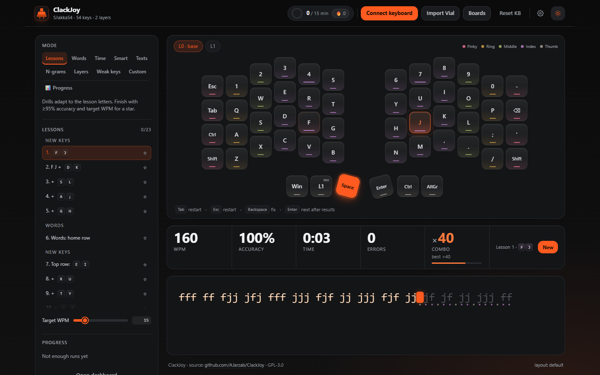

# ClackJoy

**A typing trainer that learns your keyboard instead of assuming a stock one.**

ClackJoy is a single-file typing trainer for Vial and custom split keyboards. It reads your board's real geometry and keymap, then drills the layout you actually use — your home row, your thumb keys, your layers. There is no server, no account, no build step and no runtime dependency: it works from `file://` with the network switched off.



## Try it

Live demo: **https://ajarzab.github.io/ClackJoy/**

Locally: download `index.html`, double-click it, and start typing. Nothing to install.

## Why

Most typing sites assume a stock keyboard. If you have built a split board and remapped it in Vial, their lessons are useless — they drill keys you do not have, in positions you moved. ClackJoy starts from your board's definition and live keymap, so every prompt points at a key that exists where you put it.

## Features

| Area | What you get |
| --- | --- |
| **Practice** | 23 cumulative lessons generated from the loaded board's own home row — one new key at a time, every earlier key kept in play, word lessons after each stage, then capitals, numbers, punctuation and sentences; Words (10/25/50); Time (30/60s); 40 texts; N-grams, including *weakest n-grams* ranked by your tracked latency; Layer drills for symbols, navigation, F-keys and shortcuts; Weak keys; Custom text. |
| **Keyboard view** | True geometry for any Vial board — KLE parsing, column stagger, rotated thumb keys, variable-width keys. Finger colouring with click-to-edit overrides, layer tabs with pin-to-view, next-key and next-next-key highlights, error or speed heatmap, blind mode with a continuous accuracy-based fade, soft focus. |
| **Combo** | Consecutive-correct-keystroke counter with a per-run best and an all-time best. Pressed keys catch fire from ×25 and blaze from ×100, with milestone sparks at 10/25/50/100 — switchable between glow only, full fire, or off. |
| **Stats** | WPM and accuracy history (last 500 runs), best combo per run, per-finger speed and error rate, slowest keys and bigrams, daily goal, day streak and a 20-week activity calendar. Export everything as JSON, or reset it. |
| **Sound** | Synthesised key clicks, selectable error sounds (thud, buzzer, tick, blip, bell) and correct sounds (click, soft, pop), each with a preview button. Error sounds are rate-limited so a mistake is one sound, not a burst. |
| **Themes** | Light, dark, or follow the system. |

## Supported keyboards

Any Vial keyboard can be loaded in one of three ways:

1. **Connect keyboard** (WebHID, Chrome/Edge only) — reads the board's definition and live keymap over USB HID. This also picks up the layers currently on the device.
2. **Import a `.vil`** — drag it anywhere or use *Import Vial*. ClackJoy looks the firmware uid up in its `KNOWN_BOARDS` table and fetches that board's `vial.json` from [vial-qmk](https://github.com/vial-kb/vial-qmk), caching it locally.
3. **Manual fallback** — if the board is unknown, supply its `vial.json` (or a KLE layout) so ClackJoy can build the geometry.

Firefox and Safari do not implement WebHID. On those browsers, import a `.vil` for a known board, or upload the definition manually.

Host language layouts: US QWERTY, UK QWERTY, German QWERTZ, French AZERTY and Polish (programmer).

### Adding your board

Add an entry to `var KNOWN_BOARDS` in `index.html`; `UID_MAP` is derived from entries that carry a `uid`.

```js
var KNOWN_BOARDS = [
  { name: 'Silakka54', path: 'keyboards/silakka54', uid: SILAKKA_UID },
  { name: 'Corne (crkbd)', path: 'keyboards/crkbd' },
  // add yours:
  { name: 'My Board', path: 'keyboards/vendor/myboard', uid: '123456789' }
];
```

Paths resolve against `https://raw.githubusercontent.com/vial-kb/vial-qmk/vial/<path>`, trying `<path>/keyboards/vial.json` then `<path>/keymaps/vial/vial.json`. If the uid is unknown, leave it out and say so in the PR.

## Your first session

1. Click **Connect keyboard** (Chrome/Edge), or **Import Vial** and drop a `.vil` for your board.
2. Pick a mode from the row above the keyboard — start with **Lessons**.
3. Open **Lesson 1** and type the highlighted key.
4. Follow the next-key highlight, with the fainter next-next key showing where you are heading.

## The Silakka54 preset

[`silakka54-tkl.vil`](silakka54-tkl.vil) is an example layout for the Silakka54 that gives full 87-key (TKL) coverage across 8 layers, with two thumb layers. Load it through *Import Vial*, or drag it onto the page.

> **Warning:** loading a `.vil` in Vial replaces the whole keymap, and writing it back replaces what is on the board. Back up your current layout first.

## Privacy

Everything stays local. Settings, bests, statistics and cached board definitions live in `localStorage`; the app makes no analytics or tracking requests and uploads nothing. The only network requests are the definition fetches you trigger by loading a known board.

## Contributing

Bug reports, board definitions, word lists and translations are welcome. See [CONTRIBUTING.md](CONTRIBUTING.md).

## License

ClackJoy is released under the [GNU General Public License v3.0](LICENSE). Board definitions bundled with or fetched by the app come from vial-qmk and are licensed under GPL-2.0.

## Credits

Built on the work of [Vial](https://vial.rocks), [vial-qmk](https://github.com/vial-kb/vial-qmk) and [QMK](https://qmk.fm).

<!-- Suggested GitHub description: ClackJoy is a single-file, offline typing trainer for Vial and custom split keyboards. It reads your board's real geometry and keymap, drills the layers you actually use, and tracks speed, accuracy and weak keys locally. No account, no server — download index.html and type. -->
